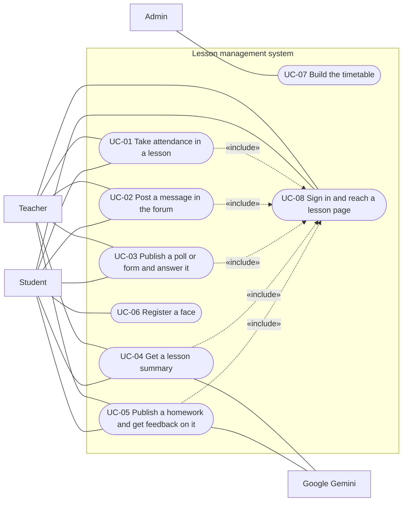

# Use cases

<!--
LECTURER GUIDELINES: USE CASES (lecture 02a, slides 3, 7, 8, 9, 10, 11, 22)
(Hidden on GitHub, visible when editing.)

"Use cases: requirements as user goals."
Answers: How do users interact with it?
Written by: analyst, UX designer. Read by: developers, testers, client.
When: with the SRS (use cases are an SRS appendix).
Cheat sheet: how each actor reaches a goal, including the errors.

Use-case template (slide 7):
1. Name and ID: verb phrase, e.g. "UC-03 Borrow a book"
2. Actor: who starts it (a person or another system)
3. Preconditions: what must be true before it starts
4. Main success flow: numbered steps, actor and system alternating
5. Alternative flows: branches and errors, numbered from the step they leave
6. Postconditions: what is guaranteed when it ends

Lecturer's example:
  UC-03 Borrow a book
  Actor: Member
  Precondition: Member is logged in and has no overdue loans
  Main flow:
    1. Member scans the book barcode
    2. System checks the book is available
    3. System records the loan, due in 14 days
    4. System shows a receipt
  Alternative: 2a. Book is reserved by another member: system offers to join
               the waiting list
  Postcondition: Book status is "on loan"

Use case vs user story (slide 8):
  Use case
    Unit: a complete user goal with all its flows
    Best for: complex interactions, many exceptions, contracts
    Lives in: the SRS or a use-case model
    Typical size: one to three pages
  User story
    Unit: one small slice of value
    Best for: agile backlogs and sprint planning
    Lives in: issue tracker such as Jira or GitHub Issues
    Typical size: one sentence plus acceptance criteria

  Example user story with acceptance criteria:
    As a member, I want to renew a loan online so that I avoid a late fee.
      Given a loan with no reservations on the book
      When I click Renew
      Then the due date moves 14 days later and I get a confirmation email

Use-case diagram (slide 10), "who does what":
  Stick figure: an actor (a role outside the system)
  Oval: a use case (one user goal)
  Box: the system boundary
  Solid line: the actor takes part
  <<include>>: always performed as part of
  <<extend>>: optional, under a condition

Activity diagram (slide 11): the same content as the use-case text, but gaps
and missing branches are easier to spot in a picture.
  Filled dot: start. Ringed dot: end. Rounded box: action.
  Diamond: decision. [guard]: condition for taking a flow.
Both diagrams go in the SRS / use cases (slide 9).

FOR OUR PROJECT
Each use case lists the requirements it covers (REQ-nn), so the SRS
traceability matrix can fill its "Use case" column.
-->

## 1. Actors

| Actor | Description |
|-------|-------------|
| Admin | Builds the timetable: courses, their teachers, weekly hours and students |
| Teacher | Runs the lessons of their courses |
| Student | Takes part in the lessons of their courses from a phone |
| Google Gemini | An outside AI service that writes the lesson summary and reviews homework |

## 2. Use-case diagram

## 3. Use cases

<!-- Template for each use case:
### UC-nn: <verb phrase>
- Actor:
- Preconditions:
- Main success flow:
  1. ...
- Alternative flows:
  - 2a. ...
- Postconditions:
- Covers: REQ-nn, REQ-nn
-->

### UC-01: Take attendance in a lesson

- Actor: Teacher. Students also take part.
- Preconditions: The teacher is on the lesson page, and every student of the course has registered a face or opted out.
- Main success flow:
  1. The teacher opens the attendance tab and takes 1 to 3 photos of the class.
  2. The teacher's phone finds the faces and sends the server only the face-prints and their positions, never the photo.
  3. The system notifies every student of the course.
  4. A student opens the app within 1 hour.
  5. The student's phone sends the student's face-print and hash, with no further action by the student.
  6. The system checks the hash, compares the face-print with those from the photo, deletes the student's face-print and records a result.
  7. The teacher's attendance sheet updates with each result.
  8. The teacher downloads the sheet.
- Alternative flows:
  - 4a. The student does not open the app within 1 hour: the result is No response.
  - 5a. The student opted out of face recognition: the student goes straight to a row-and-seat request (7a).
  - 6a. The face-print does not fit the hash: the result is Review, with no comparison.
  - 6b. The best score is below the match threshold: the result is Not found.
  - 6c. Two or more students matched the same face: the result is Conflict, and the case passes to the teacher for follow-up.
  - 7a. A student who is not marked present after the hour enters a row and seat, and the teacher approves or rejects the request. Every request is recorded, and a student with a rejected request or 3 or more requests in the course is flagged.
- Postconditions: Every student of the course has one attendance result, and the server has deleted the face-prints from the photo within 1 hour.
- Covers: REQ-10 to REQ-19, NFR-03, NFR-04, NFR-09, NFR-10

### UC-02: Post a message in the forum

- Actor: Anyone linked to the lesson.
- Preconditions: The user is on the forum tab of the lesson.
- Main success flow:
  1. The user chooses a forum from the list, by lecture number.
  2. The user writes a new message or a reply to a message.
  3. The system saves the message in the forum of that lesson.
  4. The message appears for everyone linked to the lesson without reloading the page.
- Alternative flows:
  - 2a. A student chooses to hide their name from the class: the class sees the message with no name, and the teacher sees who wrote it.
  - 3a. There is no network: the message is not sent, and the user can try again.
  - 4a. The teacher deletes a message: it disappears for everyone.
- Postconditions: The message is saved in the forum of the lesson and cannot be edited.
- Covers: REQ-20, REQ-21, REQ-23 to REQ-29, NFR-02

### UC-03: Publish a poll or form and answer it

- Actor: Teacher. Students also take part.
- Preconditions: The teacher is in the forum of the lesson. For a poll, the lesson is in progress.
- Main success flow:
  1. The teacher writes a question with at least 2 answer options and publishes a poll in the forum.
  2. The system shows the poll to every student of the lesson.
  3. A student chooses an answer.
  4. Everyone linked to the lesson sees a chart that updates without reloading the page, and the teacher also sees who gave each answer.
  5. The teacher closes the poll, and it stays in the forum.
- Alternative flows:
  - 1a. Form: the teacher builds a form of one or more questions of the four types, before or during the lesson, and publishes it in the forum. A student answers it in a window over the forum, and only the teacher sees the answers.
  - 3a. The student answers again: the answer is refused, unless the teacher allowed another answer when creating the poll or form, and then it replaces the earlier one.
  - 3b. The poll or form is closed: the answer is refused.
  - 5a. A poll that is still open at the end of the lesson closes automatically.
- Postconditions: The poll or form and its results stay in the forum of the lesson.
- Covers: REQ-30 to REQ-39, REQ-60 to REQ-69, NFR-02

### UC-04: Get a lesson summary

- Actor: Teacher. Google Gemini also takes part.
- Preconditions: The lesson has ended, and the teacher has a recording of it.
- Main success flow:
  1. The teacher uploads the recording.
  2. The system sends the full video to Google Gemini and receives a transcript with speaker labels and a list of what was on the board.
  3. The system writes the four parts of the summary, and corrects spelling mistakes and garbled copying against the transcript and the board list.
  4. The system deletes the recording and opens the summary page. If the teacher did not enter a topic, the forum title takes it from the summary.
  5. Everyone linked to the lesson opens the summary from the button in the forum.
- Alternative flows:
  - 2a. The file is too large or a usage limit is reached: the system sends the sound alone.
  - 2b. The service does not answer: the teacher gets a message and can upload again.
  - 4a. The teacher edits the text of the summary, or uploads a new recording that creates a new summary.
- Postconditions: The summary page is open, and the recording has been deleted.
- Covers: REQ-40 to REQ-49, NFR-05

### UC-05: Publish a homework and get feedback on it

- Actor: Teacher. Students and Google Gemini also take part.
- Preconditions: The teacher is on the homework tab of the lesson.
- Main success flow:
  1. The teacher publishes a homework as a PDF file, and the system generates and saves its review guide.
  2. A student presses the button next to the homework and uploads a solution as a PDF file.
  3. The system reviews the solution against the guide and shows the student a report: for each section, the score, what meets the requirements, what is missing and a direction for improvement.
  4. The system deletes the solution file and updates the chart.
  5. The students of the lesson and the teacher see the chart, and can filter it by overall score, question or section.
- Alternative flows:
  - 2a. The student has already made 3 checks: the system allows no further check.
  - 3a. A section was not answered: it gets 0 and is pointed out at the top of the report.
  - 3b. The check fails for a technical reason: it does not count, and the student can try again.
- Postconditions: The new result replaces the previous one in the chart, the third check is final, and the report does not give the solution.
- Covers: REQ-50 to REQ-59, NFR-01, NFR-06

### UC-06: Register a face

- Actor: Student.
- Preconditions: The student has signed in and has not registered a face yet.
- Main success flow:
  1. The student takes 1 photo of themselves on their phone.
  2. The phone calculates the face-print, and keeps it and the photo on the phone only.
  3. The phone sends the server only the hash, and the system saves it.
- Alternative flows:
  - 1a. The student opts out of face recognition: there is no face-print or hash, and the student's attendance is always by row and seat.
  - 2a. No face is found in the photo: the student is asked to take another one.
  - 3a. Replacing the photo: the new hash is saved only with approval from a teacher of one of the student's courses.
- Postconditions: The server holds only the hash, and the photo and the face-print stay on the phone.
- Covers: REQ-07 to REQ-09

### UC-07: Build the timetable

- Actor: Admin.
- Preconditions: The admin has signed in and has the list of students of the course.
- Main success flow:
  1. The admin creates a course with its course number, name, teacher, weekly hours and students.
  2. The system saves the course and adds its lessons to the timetable.
- Alternative flows:
  - 1a. A detail is missing or the course number already exists: the system does not save and shows what to fix.
  - 1b. Someone who is not the admin tries to change the timetable: the system refuses.
- Postconditions: The course and its lessons are in the timetable.
- Covers: REQ-02, REQ-03

### UC-08: Sign in and reach a lesson page

- Actor: Teacher or student.
- Preconditions: The user has an account.
- Main success flow:
  1. The user signs in.
  2. The system shows only the lessons of the user's courses, with no room code or join step.
  3. The user chooses a lesson.
  4. The system shows the lesson page with its three tabs.
- Alternative flows:
  - 1a. The sign-in details are wrong: the system refuses, and the user can try again.
  - 4a. The teacher enters the lecture topic, before or during the lecture, and it appears in the forum title.
- Postconditions: The user is on the page of a lesson from their own courses.
- Covers: REQ-01, REQ-04 to REQ-06, REQ-22

## 4. Activity diagrams

UC-01, the main feature:

```mermaid
flowchart TD
  start((" ")) --> photo("Teacher takes 1 to 3 photos of the class")
  photo --> send("Teacher's phone sends the server the face-prints and positions")
  send --> notify("System notifies every student of the course")
  notify --> opted{"Student opted out of face recognition?"}
  opted -->|"[yes]"| ask{"Student requests attendance by row and seat?"}
  opted -->|"[no]"| opened{"Student opened the app within 1 hour?"}
  opened -->|"[no]"| noresp("Result: No response")
  opened -->|"[yes]"| response("Student's phone sends the face-print and hash")
  response --> hash{"Does the face-print fit the hash?"}
  hash -->|"[no]"| review("Result: Review")
  hash -->|"[yes]"| compare("System compares, then deletes the student's face-print")
  compare --> score{"Best score at or above the threshold?"}
  score -->|"[no]"| notfound("Result: Not found")
  score -->|"[yes]"| other{"Another student matched the same face?"}
  other -->|"[yes]"| conflict("Result: Conflict, passed to the teacher")
  other -->|"[no]"| present("Result: Present")
  noresp --> ask
  review --> ask
  notfound --> ask
  conflict --> ask
  ask -->|"[yes]"| decide{"Teacher approves the request?"}
  ask -->|"[no]"| sheet("Attendance sheet shows the result")
  decide -->|"[yes]"| approved("Result: Present")
  decide -->|"[no]"| flagged("Request rejected, student flagged")
  present --> sheet
  approved --> sheet
  flagged --> sheet
  sheet --> download("Teacher downloads the sheet")
  download --> stop((("&nbsp;")))
  classDef dot fill:#222222,stroke:#222222
  class start,stop dot
```

## 5. User stories

<!-- As a <role>, I want <goal> so that <benefit>.
       Given ...
       When ...
       Then ...
-->
