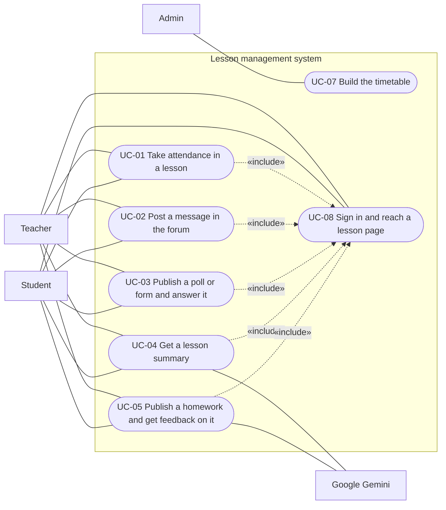

# Use cases

<!--
LECTURER GUIDELINES: USE CASES (lecture 02a, slides 3, 7, 8, 9, 10, 11, 22)
(Hidden on GitHub, visible when editing.)

"Use cases: requirements as user goals."
Answers: How do users interact with it?
Written by: analyst, UX designer. Read by: developers, testers, client.
When: with the SRS (use cases are an SRS appendix).
Cheat sheet: how each actor reaches a goal, including the errors.

Use-case template (slide 7):
1. Name and ID: verb phrase, e.g. "UC-03 Borrow a book"
2. Actor: who starts it (a person or another system)
3. Preconditions: what must be true before it starts
4. Main success flow: numbered steps, actor and system alternating
5. Alternative flows: branches and errors, numbered from the step they leave
6. Postconditions: what is guaranteed when it ends

Lecturer's example:
  UC-03 Borrow a book
  Actor: Member
  Precondition: Member is logged in and has no overdue loans
  Main flow:
    1. Member scans the book barcode
    2. System checks the book is available
    3. System records the loan, due in 14 days
    4. System shows a receipt
  Alternative: 2a. Book is reserved by another member: system offers to join
               the waiting list
  Postcondition: Book status is "on loan"

Use case vs user story (slide 8):
  Use case
    Unit: a complete user goal with all its flows
    Best for: complex interactions, many exceptions, contracts
    Lives in: the SRS or a use-case model
    Typical size: one to three pages
  User story
    Unit: one small slice of value
    Best for: agile backlogs and sprint planning
    Lives in: issue tracker such as Jira or GitHub Issues
    Typical size: one sentence plus acceptance criteria

  Example user story with acceptance criteria:
    As a member, I want to renew a loan online so that I avoid a late fee.
      Given a loan with no reservations on the book
      When I click Renew
      Then the due date moves 14 days later and I get a confirmation email

Use-case diagram (slide 10), "who does what":
  Stick figure: an actor (a role outside the system)
  Oval: a use case (one user goal)
  Box: the system boundary
  Solid line: the actor takes part
  <<include>>: always performed as part of
  <<extend>>: optional, under a condition

Activity diagram (slide 11): the same content as the use-case text, but gaps
and missing branches are easier to spot in a picture.
  Filled dot: start. Ringed dot: end. Rounded box: action.
  Diamond: decision. [guard]: condition for taking a flow.
Both diagrams go in the SRS / use cases (slide 9).

FOR OUR PROJECT
Each use case lists the requirements it covers (REQ-nn), so the SRS
traceability matrix can fill its "Use case" column.
-->

## 1. Actors

| Actor | Description |
|-------|-------------|
| Admin | Builds the timetable: courses, their teachers, weekly hours and students |
| Teacher | Runs the lessons of their courses |
| Student | Takes part in the lessons of their courses from a phone |
| Google Gemini | An outside AI service that writes the lesson summary and reviews homework |

## 2. Use-case diagram

## 3. Use cases

<!-- Template for each use case:
### UC-nn: <verb phrase>
- Actor:
- Preconditions:
- Main success flow:
  1. ...
- Alternative flows:
  - 2a. ...
- Postconditions:
- Covers: REQ-nn, REQ-nn
-->

### UC-01: Take attendance in a lesson

- Actor: Teacher. Students also take part.
- Preconditions: The teacher is on the lesson page, during the lesson.
- Main success flow:
  1. The teacher opens the attendance tab and takes one photo of the class.
  2. The teacher's phone counts the faces in the photo and sends the server only that number. The photo stays on the phone.
  3. The system notifies every student of the course, and the 4 minutes for confirming start.
  4. A student who is in the lesson presses "I was in the lesson" within the 4 minutes.
  5. The teacher's attendance sheet updates with each confirmation.
  6. When the 4 minutes end, the system compares the confirmations with the faces. No more students confirmed than there are faces, so every student who confirmed is present.
  7. The teacher downloads the sheet.
- Alternative flows:
  - 1a. The teacher does not take a photo: no student can confirm, and the teacher marks attendance by hand (8a).
  - 2a. The teacher moves to another page in the middle: the processing goes on to its end, and a short message shows when it has ended.
  - 4a. A student does not confirm within the 4 minutes: the result is Not present.
  - 6a. More students confirmed than there are faces: the teacher shares the photo with a number on every face, only from the phone that took it. The students who confirmed are notified, and each picks their number within 24 hours.
  - 6b. A number that only one student picked: that student is present.
  - 6c. Two students picked the same number, or a student says they are not in the photo: the case passes to the teacher, who approves or rejects it. Approving one pick of a number rejects the others, and a student with a rejected pick is flagged.
  - 6d. A student who confirmed does not pick a number within 24 hours: the result is Not present, and the server deletes the photo.
  - 8a. At any time the teacher changes a student's attendance by hand: the teacher's decision wins over every rule, and the teacher can take it back.
- Postconditions: Every student of the course has one attendance result, and no face-print is kept. The class photo leaves the teacher's phone when it is shared, or at once when there is no need to share it, and the server deletes a shared photo 24 hours after sharing.
- Covers: REQ-10 to REQ-19, REQ-76, NFR-03, NFR-04, NFR-09, NFR-10, NFR-13

### UC-02: Post a message in the forum

- Actor: Anyone linked to the lesson.
- Preconditions: The user is on the forum tab of the lesson.
- Main success flow:
  1. The user chooses a forum from the list, by lecture number.
  2. The user writes a new message or a reply to a message.
  3. The system saves the message in the forum of that lesson.
  4. The message appears for everyone linked to the lesson without reloading the page.
- Alternative flows:
  - 1a. The user opens the forum's conversation in an expanded window, and reads and writes in it.
  - 2a. A student chooses to hide their name from the class: the class sees the message with no name, and the teacher sees who wrote it.
  - 3a. There is no network: the message is not sent, and the user can try again.
  - 4a. The teacher deletes a message: it disappears for everyone.
- Postconditions: The message is saved in the forum of the lesson and cannot be edited.
- Covers: REQ-20, REQ-21, REQ-23 to REQ-29, REQ-70, NFR-02

### UC-03: Publish a poll or form and answer it

- Actor: Teacher. Students also take part.
- Preconditions: The teacher is in the forum of the lesson.
- Main success flow:
  1. The teacher writes a question with at least 2 answer options and publishes a poll in the forum.
  2. The system shows the poll to every student of the lesson.
  3. A student chooses an answer.
  4. Everyone linked to the lesson sees a chart that updates without reloading the page, and the teacher also sees who gave each answer.
  5. The teacher closes the poll, and it stays in the forum.
- Alternative flows:
  - 1a. Form: the teacher builds a form of one or more questions of the four types, before or during the lesson, and publishes it in the forum. A student answers it in a window over the forum, and only the teacher sees the answers.
  - 3a. The student answers again: the answer is refused, unless the teacher allowed another answer when creating the poll or form, and then it replaces the earlier one.
  - 3b. The poll or form is closed: the answer is refused.
  - 5a. A poll that was published before the end of the lesson and is still open at the end closes automatically. A poll published after the end stays open until the teacher closes it.
- Postconditions: The poll or form and its results stay in the forum of the lesson.
- Covers: REQ-30 to REQ-39, REQ-60 to REQ-69, NFR-02

### UC-04: Get a lesson summary

- Actor: Teacher. Google Gemini also takes part.
- Preconditions: The lesson has ended, and the teacher has a recording of it.
- Main success flow:
  1. The teacher uploads the recording.
  2. The system sends the full video to Google Gemini and receives a transcript with speaker labels and a list of what was on the board.
  3. The system writes a one-page summary of up to 450 words, with headings and key terms in bold: the topic of the lesson and a short opening paragraph, the main topics with the board content that adds to them, and the main questions with the teacher's answers. It then corrects spelling mistakes and garbled copying against the transcript and the board list.
  4. The system deletes the recording and shows the summary only to the teacher. If the teacher did not enter a topic, the forum title takes it from the summary.
  5. The teacher reads the summary and publishes it to the class.
  6. Everyone linked to the lesson opens the summary from the button in the forum.
- Alternative flows:
  - 1a. The teacher moves to another page in the middle of the upload: the upload goes on to its end, and a short message shows when it has ended. Closing or reloading the page asks first, because only that stops the upload.
  - 2a. The file is too large or a usage limit is reached: the system sends the sound alone.
  - 2b. The service does not answer: the teacher gets a message and can upload again.
  - 5a. The teacher edits the text of the summary, before or after publishing it, or uploads a new recording. The new recording creates a new summary, hidden from the class until the teacher publishes it.
  - 5b. The teacher hides the summary from the class again.
  - 6a. A student opens the page before the summary is published: the page says that it has not been published yet.
- Postconditions: The summary is ready, the class sees it only after the teacher has published it, and the recording has been deleted.
- Covers: REQ-40 to REQ-49, REQ-73, NFR-05, NFR-13

### UC-05: Publish a homework and get feedback on it

- Actor: Teacher. Students and Google Gemini also take part.
- Preconditions: The teacher is on the homework tab of the lesson.
- Main success flow:
  1. The teacher publishes a homework as a PDF file, and the system generates and saves its review guide.
  2. A student presses the button next to the homework and uploads a solution as a PDF file.
  3. The system reviews the solution against the guide and shows the student a report: for each section, the score, what meets the requirements, what is missing and a direction for improvement.
  4. The system deletes the solution file and updates the chart.
  5. The students of the lesson and the teacher see the chart, and can filter it by overall score, question or section.
- Alternative flows:
  - 1a. The teacher moves to another page in the middle of publishing: the publishing goes on to its end, and a short message shows when it has ended.
  - 2a. The student has already made 3 checks: the system allows no further check.
  - 3a. A section was not answered: it gets 0 and is pointed out at the top of the report.
  - 3b. The check fails for a technical reason: it does not count, and the student can try again.
  - 3c. The student moves to another page in the middle of the check: the check goes on to its end, and a short message shows when it has ended.
  - 5a. The teacher deletes the homework: after confirming, it is deleted with its file, its review guide and the students' checks, and it disappears from the tab and from the chart.
- Postconditions: The new result replaces the previous one in the chart, the third check is final, and the report does not give the solution.
- Covers: REQ-50 to REQ-59, REQ-74, NFR-01, NFR-06, NFR-13

### UC-06: Register a face (withdrawn)

Withdrawn on 2026-11-12, when personal face recognition was removed ([F1 decisions](features/F1-attendance-strategy.md)). It stays here, empty, until the design documents stop pointing to it.

- Actor: None, since students no longer register a face.
- Preconditions: None.
- Main success flow:
  1. None: attendance follows UC-01.
- Alternative flows:
  - None.
- Postconditions: No face-print or hash of a student exists.
- Covers: REQ-07 to REQ-09, all withdrawn

### UC-07: Build the timetable

- Actor: Admin.
- Preconditions: The admin has signed in and has the list of students of the course.
- Main success flow:
  1. The admin creates a course with its course number, name, teacher, weekly hours, first date, number of weeks and students.
  2. The system saves the course and adds its lessons to the timetable.
- Alternative flows:
  - 1a. A detail is missing or the course number already exists: the system does not save and shows what to fix.
  - 1b. Someone who is not the admin tries to change the timetable: the system refuses.
- Postconditions: The course and its lessons are in the timetable.
- Covers: REQ-02, REQ-03

### UC-08: Sign in and reach a lesson page

- Actor: Teacher or student.
- Preconditions: The user is on the list that the admin entered.
- Main success flow:
  1. The user signs in.
  2. The system shows a weekly timetable with only the lessons of the user's courses, with no room code or join step. Above it, a card leads to the lesson happening now, or else to the next one. The top of every screen shows the user's name and role.
  3. The user chooses a lesson from the card or from the timetable.
  4. The system shows the lesson page with its three tabs.
- Alternative flows:
  - 1a. The sign-in details are wrong: the system refuses, and the user can try again.
  - 1b. First sign-in: the user enters their ID number and chooses a password. The system refuses someone who is not on the list or who has already chosen a password.
  - 2a. On a phone the timetable shows one day at a time, under a strip of the days of the week, and opens on today. The user can move to another day or another week.
  - 4a. The teacher enters the lecture topic, before or during the lecture, and it appears in the forum title.
- Postconditions: The user is on the page of a lesson from their own courses.
- Covers: REQ-01, REQ-04 to REQ-06, REQ-22, REQ-71, REQ-72

## 4. Activity diagrams

UC-01, the main feature:

```mermaid
flowchart TD
  start((" ")) --> photo("Teacher takes one photo of the class")
  photo --> count("Teacher's phone sends the server only the number of faces")
  count --> notify("System notifies every student of the course")
  notify --> confirmed{"Student confirms within the 4 minutes?"}
  confirmed -->|"[no]"| absent("Result: Not present")
  confirmed -->|"[yes]"| more{"More confirmations than faces?"}
  more -->|"[no]"| present("Result: Present")
  more -->|"[yes]"| share("Teacher shares the photo with a number on every face")
  share --> picked{"Student picks within 24 hours?"}
  picked -->|"[no]"| absent
  picked -->|"[yes]"| alone{"Only this student picked that number?"}
  alone -->|"[yes]"| present
  alone -->|"[no, or not in the photo]"| decide{"Teacher approves the pick?"}
  decide -->|"[yes]"| present
  decide -->|"[no]"| flagged("Result: Not present, student flagged")
  present --> sheet("Attendance sheet shows the result")
  absent --> sheet
  flagged --> sheet
  sheet --> change{"Teacher changes it by hand?"}
  change -->|"[yes]"| teacher("Result: the teacher's decision")
  change -->|"[no]"| download("Teacher downloads the sheet")
  teacher --> download
  download --> stop((("&nbsp;")))
  classDef dot fill:#222222,stroke:#222222
  class start,stop dot
```

## 5. User stories

<!-- As a <role>, I want <goal> so that <benefit>.
       Given ...
       When ...
       Then ...
-->

- As a teacher, I want attendance to take one photo and a few minutes so that I do not waste lesson time.
  - Given the students are in the hall
  - When I take one photo and they press "I was in the lesson" within 4 minutes
  - Then the sheet shows every student who confirmed as present, when no more confirmed than there are faces
- As a student, I want to ask a question in the forum without showing my name to the class so that I am not embarrassed to ask.
  - Given I am in the forum of the lesson
  - When I write a message and choose to hide my name
  - Then the class sees it with no name and the teacher sees who wrote it
- As a teacher, I want to publish a quick poll during the lesson so that I can check that the class understood.
  - Given the lesson is in progress
  - When I publish a poll and a student answers
  - Then the chart updates for everyone without reloading the page
- As a student, I want to read a summary of the lesson so that I can go over the material.
  - Given the lesson has ended, and the teacher has uploaded a recording and published the summary
  - When I press the button in the forum
  - Then a page opens with a one-page summary of the lesson
- As a student, I want feedback on my homework before submitting it so that I can fix what is missing.
  - Given the homework is published and I have checks left
  - When I upload a solution
  - Then a report opens with a score and what is missing for each section, without the solution
- As a student who was in the lesson, I want to point to my face in the class photo when someone confirmed without being there so that I am still marked present.
  - Given more students confirmed than there are faces, and the teacher shared the photo
  - When I pick the number on my face and no other student picks it
  - Then I am marked present
- As an admin, I want to create a course with its students so that everyone reaches the lessons with no code.
  - Given I have the list of students
  - When I create a course
  - Then its lessons appear for the teacher and the students
- As a student, I want to see only my own lessons so that I reach the right lesson quickly.
  - Given I have an account
  - When I sign in
  - Then I see only the lessons of my courses
