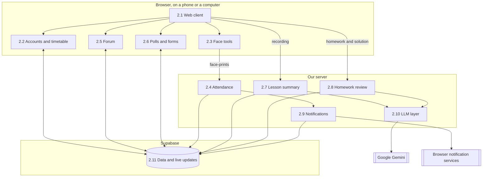
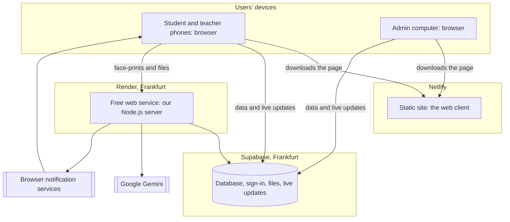

# Software Design Document (SDD)

<!--
LECTURER GUIDELINES: SDD, SOFTWARE DESIGN DOCUMENT (lecture 02a, slides 3, 9, 12, 13, 22)
(Hidden on GitHub, visible when editing.)

Assignment step 6: "Define the main software components."

"SDD: the architecture of the whole system."
Answers: How is the system structured?
Written by: architect. Read by: team leads, developers.
When: architecture design. Changes rarely.
Cheat sheet: the parts of the system and how they connect.

What the SDD contains (slide 12):
- Context: users and external systems
- Decomposition: subsystems and components
- Interfaces: how components communicate
- Data: main entities and storage
- Deployment: servers, containers, cloud
- Rationale: alternatives and why this one

Lecturer's example component view (library system):
  Web client, Mobile app
    to API gateway + authentication
      to Loan service, Catalogue service, Notification service
        to PostgreSQL, Message queue

UML diagrams that go in the SDD (slide 9):
- Component: deployable parts and the interfaces between them
- Deployment: servers, devices and what runs on each
- Class: classes, attributes, operations and relationships
  (high level here; the detail goes in the EDD, step 7)

SDD vs EDD (slide 13):
  Scope:          SDD whole system          / EDD one component or feature
  Question:       SDD "What are the parts?" / EDD "How is this part built?"
  Readers:        SDD architects, all teams / EDD implementers, reviewers
  Typical content: SDD block and deployment diagrams / EDD classes, algorithms, schemas
  Changes:        SDD rarely                / EDD often, per feature

Traceability (slide 19): other documents point at SDD sections
(e.g. "SDD §4.2 Loan service"), so number the sections.

PDR (lecture 03a, slide 6): the review package includes a draft SDD
(architecture and main components) and alternatives considered and why
rejected. Exit criterion: every requirement allocated to a component.

FOR OUR PROJECT
Draw diagrams in Mermaid. Section 2 has one numbered subsection per component
(2.1, 2.2, ...) so the traceability matrix can cite "SDD §2.1".
-->

## 1. Context

<!-- Users (student, lecturer) and external systems (LLM API, video source, spreadsheet). Context diagram. -->

The product runs in-person lessons from a phone: photo attendance, a forum with polls and forms, lesson summaries and homework feedback.

| Actor or system | Role |
|-----------------|------|
| Student | Uses a phone browser to register a face once, answer attendance, write in the forum, answer polls and forms and check homework |
| Teacher | Uses a phone browser to photograph the class, approve requests, publish polls, forms and homework and upload recordings |
| Admin | Uses a computer browser to build the timetable |
| Google Gemini | AI service that generates review guides, reviews homework and summarises recordings |
| Browser notification services | Deliver a notification to a student's phone |
| Phone camera | Takes the registration photo and the class photos, through the browser |
| Spreadsheet program | Opens the attendance sheet that the teacher downloads |

## 2. Decomposition

<!-- Component diagram (Mermaid), then one subsection per component:
### 2.n <Component name>
- Responsibility:
- Requirements covered: REQ-nn
-->

The product has three deployable parts: the web client in the browser, our server, and Supabase. The page talks to Supabase directly for data and live updates. It goes through our server only for the four jobs that need a secret key or a decision that a student's phone must not make: comparing face-prints, lesson summaries, homework reviews and sending notifications.

### 2.1 Web client

- **Runs in:** the browser, as static files built with React and Vite (ADR-4).
- **Responsibility:** the screens: sign-in, the first screen by role and the lesson page with its three tabs. It fits every screen width and calls the other components.
- **Requirements covered:** REQ-06, NFR-07, NFR-12.

### 2.2 Accounts and timetable

- **Runs in:** the web client, with its data in Supabase.
- **Responsibility:** sign-in, roles, courses, weekly hours and who is linked to which lesson. Access rules in the database decide who may see and change what.
- **Requirements covered:** REQ-01 to REQ-05.

### 2.3 Face tools

- **Runs in:** the browser on the phone, with OpenCV.js and ONNX Runtime Web (ADR-1).
- **Responsibility:** makes a face-print from the registration photo and keeps it on the student's phone. Finds the faces in a class photo and makes their face-prints. Photos never leave the phone.
- **Requirements covered:** REQ-07 to REQ-10, NFR-04.

### 2.4 Attendance

- **Runs in:** our server for the comparison, and the web client for the requests and the sheet.
- **Responsibility:** keeps the class face-prints for 1 hour, compares each student's face-print with them, applies the rules of REQ-13 and saves the result. Handles the row-and-seat requests, shows the attendance sheet and writes it as a file (ADR-6).
- **Requirements covered:** REQ-12 to REQ-19, NFR-03, NFR-09, NFR-10.

### 2.5 Forum

- **Runs in:** the web client, with its data and live updates in Supabase.
- **Responsibility:** one forum per lesson date, with messages, replies, hidden names, deletion by the teacher, the list of forums and the expanded conversation.
- **Requirements covered:** REQ-20 to REQ-29, REQ-70.

### 2.6 Polls and forms

- **Runs in:** the web client, with its data and live updates in Supabase.
- **Responsibility:** quick polls and forms of four question types (ADR-7), opening and closing them, one answer per student, the live chart of a poll, and showing who answered only to the teacher.
- **Requirements covered:** REQ-30 to REQ-39, REQ-60 to REQ-69.

### 2.7 Lesson summary

- **Runs in:** our server, with the summary page in the web client.
- **Responsibility:** receives a recording, sends it to the AI service through the LLM layer (ADR-2), builds and reviews the four parts of the summary, deletes the recording and lets the teacher edit the text.
- **Requirements covered:** REQ-40 to REQ-49, NFR-05.

### 2.8 Homework review

- **Runs in:** our server, with the homework tab in the web client.
- **Responsibility:** generates the review guide when a homework is published, checks a solution against it, calculates the scores on the server, allows 3 checks per student, deletes the solution and feeds the class chart.
- **Requirements covered:** REQ-50 to REQ-59, NFR-01, NFR-06.

### 2.9 Notifications

- **Runs in:** our server.
- **Responsibility:** keeps each student's browser subscription and notifies the course after the teacher has taken the photos.
- **Requirements covered:** REQ-11.

### 2.10 LLM layer

- **Runs in:** our server. It already exists in [app/server/src/llm/](../app/server/src/llm/).
- **Responsibility:** the only path to the AI service. It hides the provider, allows a fake in tests and keeps the key on the server.
- **Requirements covered:** NFR-08.

### 2.11 Data and live updates

- **Runs in:** Supabase (ADR-3).
- **Responsibility:** the database, sign-in, files and access rules per table, sending new rows to connected pages, and a job that runs every minute to delete expired class face-prints and close polls.
- **Requirements covered:** NFR-02.

## 3. Interfaces

<!-- How the components communicate: REST endpoints, realtime events, external APIs. -->

| From | To | How | What passes |
|------|----|-----|-------------|
| Web client | Data and live updates | HTTPS through the Supabase client library, with the public key and the user's sign-in token | Reading and writing the data that the access rules allow |
| Data and live updates | Web client | A WebSocket connection | New forum messages, poll answers and attendance results, as database changes |
| Web client | Our server | HTTPS with JSON or a file, and the user's sign-in token | The calls in the table below |
| Our server | Data and live updates | HTTPS with the secret key | Results, and the tables closed to the page |
| LLM layer | Google Gemini | HTTPS through the Google SDK, with the service key | Files and prompts, and answers in a fixed structure |
| Notifications | Browser notification services | Web Push | A notification to each subscribed student |
| Face tools | Phone camera | The browser's camera interface | Photos, which stay on the phone |

The calls to our server:

| Call | Caller | Purpose |
|------|--------|---------|
| `GET /health` | Web client | Wakes the server when the teacher opens the lesson |
| `POST /faces/register` | Student | Saves the hash of a new face-print, a request to replace it, or an opt-out |
| `POST /attendance/class` | Teacher | Sends the face-prints and positions from the class photos and starts the hour |
| `POST /attendance/response` | Student | Sends the student's face-print and hash, and returns the result |
| `POST /notifications/subscribe` | Student | Saves the browser's subscription |
| `POST /summaries` | Teacher | Uploads a recording and starts the summary |
| `POST /homework` | Teacher | Publishes a homework PDF and generates its review guide |
| `POST /homework/{id}/checks` | Student | Uploads a solution and returns the report |

The server checks the sign-in token on every call. The page waits for the answer of every call except one. A lesson summary takes minutes, so `POST /summaries` answers as soon as the upload ends, before it calls the AI service, and its answer says only that the work has started. The server then creates the summary in the background and writes its status (in progress, ready or failed) and its text to the database. The page receives the change as a live update, or reads it when it is opened again. If the server stops in the middle, for example because it went to sleep 15 minutes after its last incoming request, the status stays in progress. After 15 minutes the page shows that the summary failed and lets the teacher upload the recording again. The requests and responses of each call are in the EDD of its component.

## 4. Data

<!-- Main entities and where they are stored. -->

All lasting data is in Supabase, because the server's disk is temporary (ADR-5). The entities are those of the [SRS data dictionary](04-SRS.md).

| Entity | Stored in | Who can read it | Note |
|--------|-----------|-----------------|------|
| User, course, lesson | Database | Everyone linked to them | |
| A student's face-print | The student's phone | Nobody else | In the server's memory only during the comparison (NFR-09) |
| Face registration (hash) | Database, closed to the page | The server | |
| Class face-prints | Database, closed to the page | The server | Deleted within 1 minute of the end of the hour (NFR-10) |
| Attendance result | Database | The student and the teacher | Written only by the server |
| Row-and-seat request | Database | The student and the teacher | |
| Forum message | Database | Everyone linked to the lesson | |
| Writer of a message with a hidden name | Database, apart from the message | The teacher | |
| Poll and form | Database | Everyone linked to the lesson | |
| Answer | Database | A poll's totals: everyone linked. Who answered, and all form answers: the teacher | |
| Lesson summary | Database | Everyone linked to the lesson | Holds its status: in progress, ready or failed |
| Recording | The server's temporary disk | The server | Deleted once the summary is ready (REQ-48) |
| Homework file | File storage | Everyone linked to the lesson | |
| Review guide | Database, closed to the page | The server | It holds the expected answers |
| Solution file | The server's memory | The server | Deleted within 1 minute (REQ-59) |
| Homework check | Database | The report: that student. The scores: everyone linked, for the chart | |
| Browser subscription | Database, closed to the page | The server | |
| Attendance sheet | Not stored | The teacher | Written in the browser from the attendance results |

## 5. Deployment

<!-- Deployment diagram: student phone (browser), lecturer laptop, server / BaaS, external APIs. -->

| Part | Where it runs | Plan |
|------|---------------|------|
| Web client | Static site on Netlify, served from its CDN | Free: 300 credits a month |
| Our server | Web service on Render, in Frankfurt | Free: 0.1 CPU and 512 MB of memory |
| Data | Supabase, in Frankfurt | Free |
| AI service | Google Gemini | Free tier |

The static site does not depend on our server, so the forum, the polls and the forms keep working while the server sleeps. The server sleeps after 15 minutes without traffic, and the page wakes it when the teacher opens a lesson (ADR-5). Each production publish on Netlify uses 15 of the 300 monthly credits, and at zero the site stops until the next month, so automatic publishing is off and the team publishes at milestones (R22).

## 6. Rationale

<!-- Alternatives and why this one. Link to the ADRs in 02-tools-report.md. -->

The choice of each tool, with its alternatives, is in the ADRs of the [tools report](02-tools-report.md): ADR-1 to ADR-8. These are the decisions about the structure:

| Decision | Alternative | Why this one | Record |
|----------|-------------|--------------|--------|
| The page talks to the database directly, and goes through our server for four jobs only | All traffic through our server | A sleeping server would stop the whole site, and 0.1 CPU would carry all the traffic. Access rules per table replace a single gate | ADR-3, ADR-5 |
| One server for all the server jobs | A separate service per feature | One class needs one deployment, and a free plan runs one small instance | This section |
| Faces are compared on the server | On the student's phone | A student's phone must not decide that its owner is present | Tools report, section 2.4 |
| Photos stay on the phone, and only face-prints leave it | Comparing photos on the server | The server never holds a photo of a person | ADR-1 |
| The web client is a separate static site, on Netlify | Our server also serves the page | The site stays up while the server sleeps | ADR-4, ADR-5 |
| A summary runs in the background | The page waits for the answer | A phone can lock its screen during the minutes the summary takes | This section |

## 7. Requirement allocation

| Requirement | Component (SDD §) |
|-------------|-------------------|
| NFR-01 | §2.8 Homework review |
| NFR-02 | §2.11 Data and live updates |
| NFR-03 | §2.4 Attendance |
| NFR-04 | §2.3 Face tools |
| NFR-05 | §2.7 Lesson summary |
| NFR-06 | §2.8 Homework review |
| NFR-07 | §2.1 Web client |
| NFR-08 | §2.10 LLM layer |
| NFR-09 | §2.4 Attendance |
| NFR-10 | §2.4 Attendance |
| NFR-11 | §5 Deployment |
| NFR-12 | §2.1 Web client |
| REQ-01 | §2.2 Accounts and timetable |
| REQ-02 | §2.2 Accounts and timetable |
| REQ-03 | §2.2 Accounts and timetable |
| REQ-04 | §2.2 Accounts and timetable |
| REQ-05 | §2.2 Accounts and timetable |
| REQ-06 | §2.1 Web client |
| REQ-07 | §2.3 Face tools |
| REQ-08 | §2.3 Face tools |
| REQ-09 | §2.3 Face tools |
| REQ-10 | §2.3 Face tools |
| REQ-11 | §2.9 Notifications |
| REQ-12 | §2.4 Attendance |
| REQ-13 | §2.4 Attendance |
| REQ-14 | §2.4 Attendance |
| REQ-15 | §2.4 Attendance |
| REQ-16 | §2.4 Attendance |
| REQ-17 | §2.4 Attendance |
| REQ-18 | §2.4 Attendance |
| REQ-19 | §2.4 Attendance |
| REQ-20 | §2.5 Forum |
| REQ-21 | §2.5 Forum |
| REQ-22 | §2.5 Forum |
| REQ-23 | §2.5 Forum |
| REQ-24 | §2.5 Forum |
| REQ-25 | §2.5 Forum |
| REQ-26 | §2.5 Forum |
| REQ-27 | §2.5 Forum |
| REQ-28 | §2.5 Forum |
| REQ-29 | §2.5 Forum |
| REQ-30 | §2.6 Polls and forms |
| REQ-31 | §2.6 Polls and forms |
| REQ-32 | §2.6 Polls and forms |
| REQ-33 | §2.6 Polls and forms |
| REQ-34 | §2.6 Polls and forms |
| REQ-35 | §2.6 Polls and forms |
| REQ-36 | §2.6 Polls and forms |
| REQ-37 | §2.6 Polls and forms |
| REQ-38 | §2.6 Polls and forms |
| REQ-39 | §2.6 Polls and forms |
| REQ-40 | §2.7 Lesson summary |
| REQ-41 | §2.7 Lesson summary |
| REQ-42 | §2.7 Lesson summary |
| REQ-43 | §2.7 Lesson summary |
| REQ-44 | §2.7 Lesson summary |
| REQ-45 | §2.7 Lesson summary |
| REQ-46 | §2.7 Lesson summary |
| REQ-47 | §2.7 Lesson summary |
| REQ-48 | §2.7 Lesson summary |
| REQ-49 | §2.7 Lesson summary |
| REQ-50 | §2.8 Homework review |
| REQ-51 | §2.8 Homework review |
| REQ-52 | §2.8 Homework review |
| REQ-53 | §2.8 Homework review |
| REQ-54 | §2.8 Homework review |
| REQ-55 | §2.8 Homework review |
| REQ-56 | §2.8 Homework review |
| REQ-57 | §2.8 Homework review |
| REQ-58 | §2.8 Homework review |
| REQ-59 | §2.8 Homework review |
| REQ-60 | §2.6 Polls and forms |
| REQ-61 | §2.6 Polls and forms |
| REQ-62 | §2.6 Polls and forms |
| REQ-63 | §2.6 Polls and forms |
| REQ-64 | §2.6 Polls and forms |
| REQ-65 | §2.6 Polls and forms |
| REQ-66 | §2.6 Polls and forms |
| REQ-67 | §2.6 Polls and forms |
| REQ-68 | §2.6 Polls and forms |
| REQ-69 | §2.6 Polls and forms |
| REQ-70 | §2.5 Forum |
