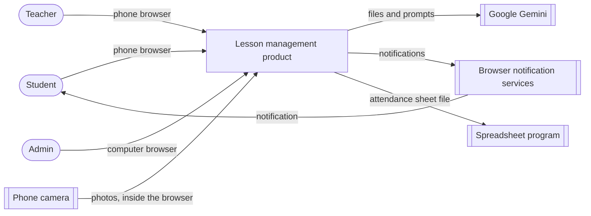

# Software Design Document (SDD)

<!--
LECTURER GUIDELINES: SDD, SOFTWARE DESIGN DOCUMENT (lecture 02a, slides 3, 9, 12, 13, 22)
(Hidden on GitHub, visible when editing.)

Assignment step 6: "Define the main software components."

"SDD: the architecture of the whole system."
Answers: How is the system structured?
Written by: architect. Read by: team leads, developers.
When: architecture design. Changes rarely.
Cheat sheet: the parts of the system and how they connect.

What the SDD contains (slide 12):
- Context: users and external systems
- Decomposition: subsystems and components
- Interfaces: how components communicate
- Data: main entities and storage
- Deployment: servers, containers, cloud
- Rationale: alternatives and why this one

Lecturer's example component view (library system):
  Web client, Mobile app
    to API gateway + authentication
      to Loan service, Catalogue service, Notification service
        to PostgreSQL, Message queue

UML diagrams that go in the SDD (slide 9):
- Component: deployable parts and the interfaces between them
- Deployment: servers, devices and what runs on each
- Class: classes, attributes, operations and relationships
  (high level here; the detail goes in the EDD, step 7)

SDD vs EDD (slide 13):
  Scope:          SDD whole system          / EDD one component or feature
  Question:       SDD "What are the parts?" / EDD "How is this part built?"
  Readers:        SDD architects, all teams / EDD implementers, reviewers
  Typical content: SDD block and deployment diagrams / EDD classes, algorithms, schemas
  Changes:        SDD rarely                / EDD often, per feature

Traceability (slide 19): other documents point at SDD sections
(e.g. "SDD §4.2 Loan service"), so number the sections.

PDR (lecture 03a, slide 6): the review package includes a draft SDD
(architecture and main components) and alternatives considered and why
rejected. Exit criterion: every requirement allocated to a component.

FOR OUR PROJECT
Draw diagrams in Mermaid. Section 2 has one numbered subsection per component
(2.1, 2.2, ...) so the traceability matrix can cite "SDD §2.1".
-->

## 1. Context

<!-- Users (student, lecturer) and external systems (LLM API, video source, spreadsheet). Context diagram. -->

The product runs in-person lessons from a phone: photo attendance, a forum with polls and forms, lesson summaries and homework feedback.

| Actor or system | Role |
|-----------------|------|
| Student | Uses a phone browser to register a face once, answer attendance, write in the forum, answer polls and forms and check homework |
| Teacher | Uses a phone browser to photograph the class, approve requests, publish polls, forms and homework and upload recordings |
| Admin | Uses a computer browser to build the timetable |
| Google Gemini | AI service that generates review guides, reviews homework and summarises recordings |
| Browser notification services | Deliver a notification to a student's phone |
| Phone camera | Takes the registration photo and the class photos, through the browser |
| Spreadsheet program | Opens the attendance sheet that the teacher downloads |

## 2. Decomposition

<!-- Component diagram (Mermaid), then one subsection per component:
### 2.n <Component name>
- Responsibility:
- Requirements covered: REQ-nn
-->

## 3. Interfaces

<!-- How the components communicate: REST endpoints, realtime events, external APIs. -->

## 4. Data

<!-- Main entities and where they are stored. -->

## 5. Deployment

<!-- Deployment diagram: student phone (browser), lecturer laptop, server / BaaS, external APIs. -->

## 6. Rationale

<!-- Alternatives and why this one. Link to the ADRs in 02-tools-report.md. -->

## 7. Requirement allocation

| Requirement | Component (SDD §) |
|-------------|-------------------|
