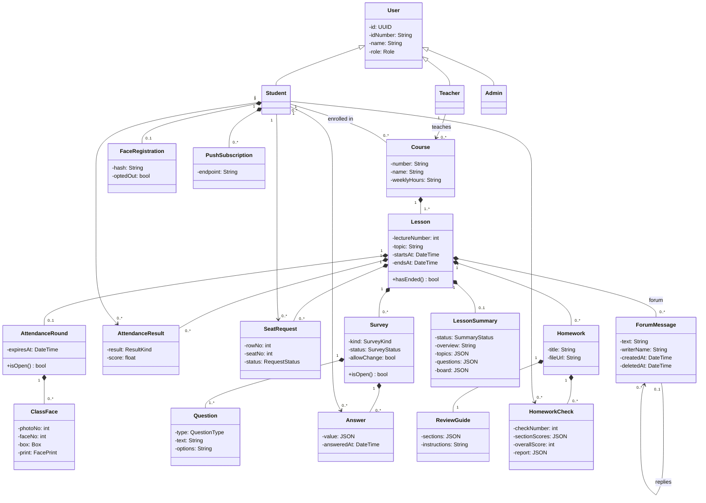

# Detailed Design (EDD)

<!--
LECTURER GUIDELINES: EDD, ENGINEERING DESIGN DOCUMENT (lecture 02a, slides 3, 9, 13-17, 22)
(Hidden on GitHub, visible when editing.)

Assignment step 7: "Define low-level class diagrams and sequence diagrams."

"EDD: the engineering detail of one component."
Answers: How is this component built?
Written by: component engineer. Read by: implementers, reviewers.
When: before coding each part. Changes often, per feature.
Cheat sheet: how one part is built, and why this way.
Scope: ONE component or feature, so write one EDD file per main component
(copy _template.md).

What goes in an EDD (slide 13):
1. Module and class design
2. Algorithms and data structures
3. Database schema and data formats
4. Sequence diagrams for key flows
5. Error handling and edge cases
6. Configuration and performance budget
7. Alternatives considered and trade-offs
8. Testing and rollout plan

CLASS DIAGRAM (slide 14), notation:
  Box: name, attributes, operations
  + / - : public / private
  Italic name: abstract class
  Hollow triangle: inheritance ("is a")
  Filled diamond: composition (part of, same lifetime)
  1, 0..* : multiplicity of an association
Lecturer's example (loan domain):
  Person (- name: String, - email: String)
  Librarian is a Person (- staffId: String, + registerMember())
  Member is a Person (- memberId: String, - maxLoans: int = 5, + canBorrow(): bool)
  Book (- isbn: String, - title: String, + availableCopies(): int)
  Copy (- copyId: String, - status: CopyStatus, + isAvailable(): bool)
  Loan (- dueDate: Date, - returned: bool, + renew(), + isOverdue(): bool)
  Member 1 "borrows" 0..* Loan;  Loan 0..* "for" 1 Copy;  Book 1 has 1..* Copy

SEQUENCE DIAGRAM (slide 15), notation:
  Solid arrow, filled head: synchronous call
  Dashed arrow: return
  Narrow bar: activation (the object is busy)
  Dashed line: lifeline
Lecturer's example (creating a loan):
  :Client, :LoanController, :LoanService, :CopyRepository, :LoanRepository
  1: POST /loans (Client to LoanController)
  2: createLoan(m, c) (LoanController to LoanService)
  3: findById(copyId) (LoanService to CopyRepository), returns copy
  4: save(loan) (LoanService to LoanRepository), returns loanId
  loan is returned to the controller, which answers 201 Created
Sequence diagrams go in the EDD and the API docs (slide 9).

STATE MACHINE (slide 16): the states of one object and the events that
change them. Goes in the EDD and the STD (slide 9).
  Rounded box: state
  Arrow: transition labelled "event [guard] / action"
  Filled dot: initial state. Ringed dot: final state.
Lecturer's example (life of a book copy): Available, On loan, Overdue,
Reserved, Lost. borrow / return; due date passed; return / charge fine;
reserve / cancel; borrow [by reserving member]; after 60 days / bill member.

API DOCS (slide 17), "the contract for other developers":
  Answers: How do I call this interface? Written by developers, read by
  client developers, written with the code.
  1. Overview and authentication: base URL, versioning, how to get and send a token
  2. Endpoint reference: method, path, purpose, parameters and body
  3. Responses and errors: status codes with meaning and error format
  4. Examples: real request and response for each call
  5. Limits and changes: rate limits, pagination, changelog, deprecations
  Lecturer's example:
    POST /api/v1/loans   (Authorization: Bearer <token>)
    { "memberId": "M-1042", "bookId": "B-7781" }
    201 Created   { "loanId": "L-55120", "dueDate": "2026-10-30" }
    404 Not Found   unknown book
    409 Conflict    book already on loan
  Tools: OpenAPI / Swagger, Redoc, Postman collections.

CDR (lecture 03a, slide 7): the review package includes "an EDD for each
component", "interface specifications and API docs" and "database schema and
key algorithms".

FOR OUR PROJECT
Name each EDD (EDD-Attendance, EDD-Polls, ...) so the traceability matrix and
the STP/STD (step 8) can cite it. The STP plans unit tests per class from here.
Mermaid supports classDiagram, sequenceDiagram and stateDiagram-v2.
-->

## Domain model (class diagram)

<!-- The whole domain in one class diagram. Each EDD then zooms into its own classes. -->

## Component EDDs

| EDD | Component (SDD §) | File |
|-----|-------------------|------|
| EDD-Attendance | §2.3 Face tools, §2.4 Attendance, §2.9 Notifications | [attendance.md](attendance.md) |
| EDD-Forum | §2.5 Forum | [forum.md](forum.md) |
| EDD-Polls | §2.6 Polls and forms | [polls-and-forms.md](polls-and-forms.md) |
| EDD-LessonSummary | §2.7 Lesson summary | [lesson-summary.md](lesson-summary.md) |

<!-- To add one: copy _template.md to <component>.md and fill it in. -->

The web client (§2.1), accounts and timetable (§2.2), the LLM layer (§2.10) and the data store (§2.11) have no EDD of their own. The domain model above, the API docs below and the code in [app/server/src/llm/](../../app/server/src/llm/) describe them.

## API docs

<!-- Endpoints of the web app: overview and auth, endpoint reference, responses
and errors, examples, limits. Can move to its own file (api.md) when it grows. -->

### Overview and authentication

- **Base URL:** the address of the server on Render. There is one version of the API, so addresses carry no version.
- **Authentication:** every call except `GET /health` sends `Authorization: Bearer <token>`, with the user's Supabase sign-in token. The server checks it on every call.
- **Callers:** the server accepts browser calls only from the address of the web client on Netlify.
- **Format:** JSON, except the calls that carry a file, which use `multipart/form-data`. Express handles the routes and multer the uploads.

### Endpoint reference

| Call | Caller | Request example | Success example |
|------|--------|-----------------|-----------------|
| `GET /health` | Web client | No body | `200 {"ok": true}` |
| `POST /faces/register` | Student | `{"hash": "9f2c41..."}` or `{"optOut": true}` | `201 {"status": "registered"}`, or `202 {"status": "waiting_for_teacher"}` when replacing a face |
| `POST /attendance/class` | Teacher of the lesson | `{"lessonId": "c1a7...", "photos": [{"faces": [{"box": [120, 88, 46, 46], "print": [0.021, -0.113, "... 128 numbers"]}]}]}` | `201 {"expiresAt": "2026-12-01T11:12:00Z"}` |
| `POST /attendance/response` | Student of the lesson | `{"lessonId": "c1a7...", "print": [0.018, -0.097, "... 128 numbers"], "hash": "9f2c41..."}` | `200 {"result": "present"}` |
| `POST /notifications/subscribe` | Student | `{"endpoint": "https://fcm.googleapis.com/...", "keys": {"p256dh": "BN3...", "auth": "k1v..."}}` | `204`, no body |
| `POST /summaries` | Teacher of the lesson | Form fields `lessonId` and `recording` (a video file) | `202 {"status": "in_progress"}` |
| `POST /homework` | Teacher of the lesson | Form fields `lessonId`, `title` and `file` (a PDF) | `201 {"homeworkId": "7be2...", "questions": 4}` |
| `POST /homework/{id}/checks` | Student of the lesson | Form field `solution` (a PDF) | `200 {"checkNumber": 1, "overall": 72, "report": {"sections": ["..."]}}` |

### Responses and errors

Every error has the same form: `{"error": "round_closed", "message": "The hour for responding is over."}`.

| Status | Meaning | Error codes |
|--------|---------|-------------|
| 400 | The request is not valid | `bad_print`, `not_a_pdf` |
| 401 | The sign-in token is missing or not valid | `not_signed_in` |
| 403 | The user may not do this | `not_the_teacher`, `not_in_course`, `outside_lesson` |
| 404 | The lesson, homework or round does not exist | `not_found`, `no_round` |
| 409 | The current state does not allow it | `round_exists`, `round_closed`, `summary_in_progress`, `lesson_not_ended`, `no_checks_left` |
| 413 | The file is too large | `file_too_large` |
| 503 | The AI service failed. A homework check that ends here does not count | `ai_unavailable` |

### Limits and changes

- A JSON body can be up to 1 MB, a recording up to 200 MB and a PDF up to 20 MB.
- A student has 3 checks per homework (REQ-56), and no call returns pages of results.
- The first call after the server has slept can take up to 92 s (ADR-5).
- A change that breaks a call is recorded here, with its date.
