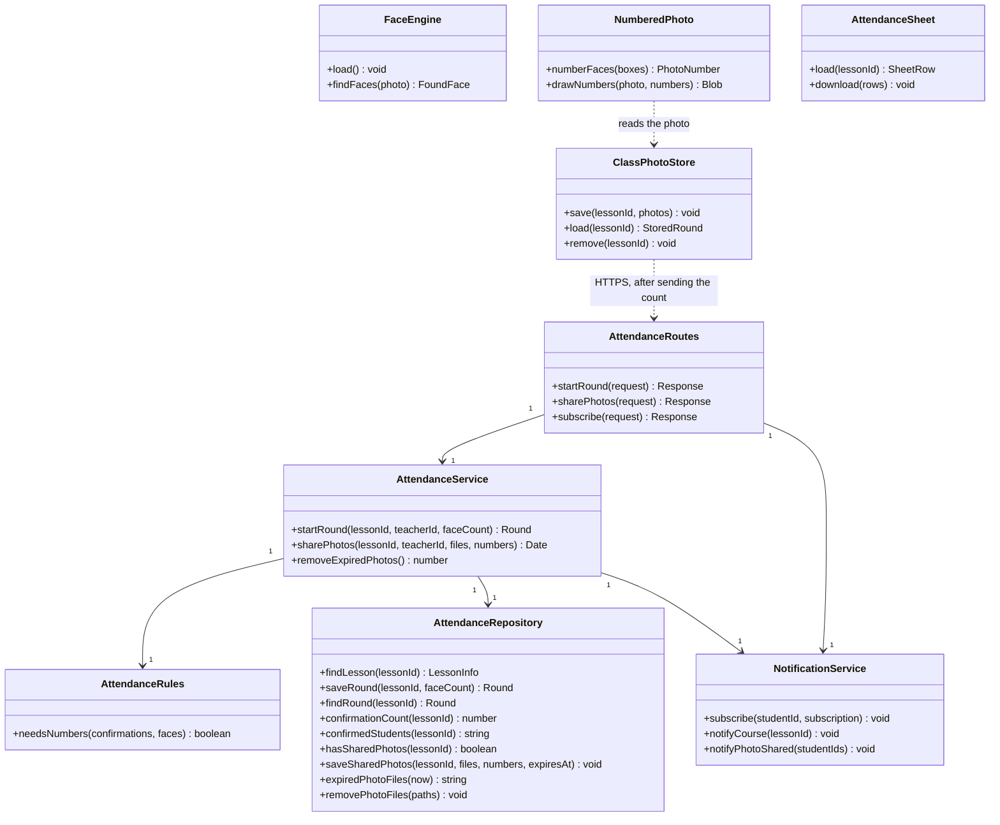
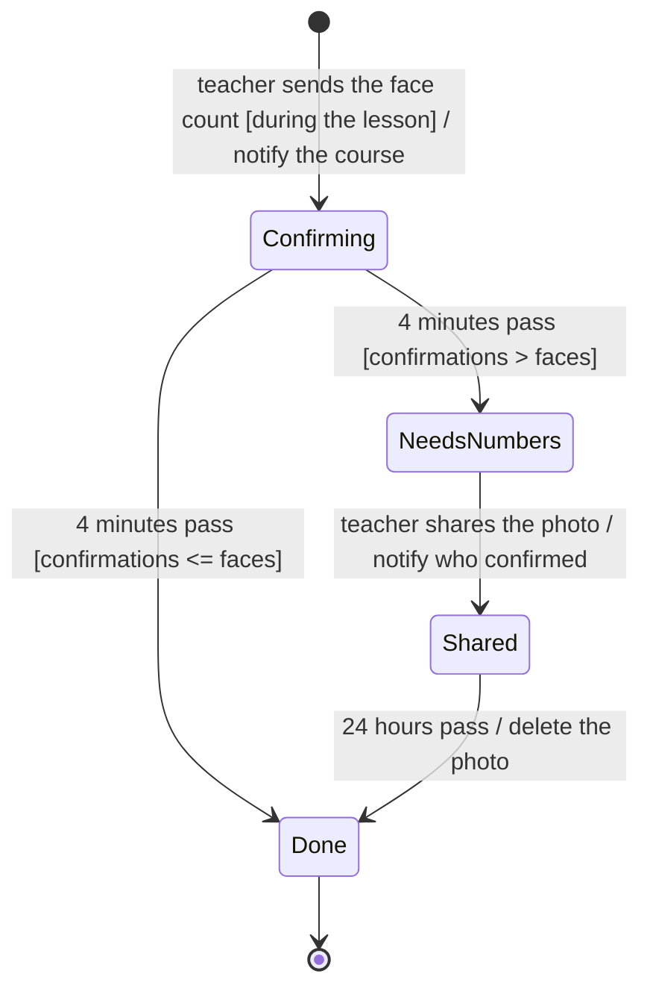
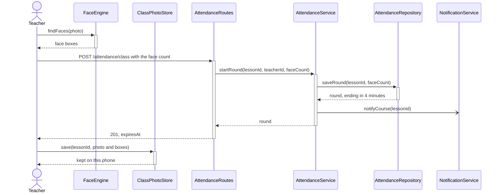
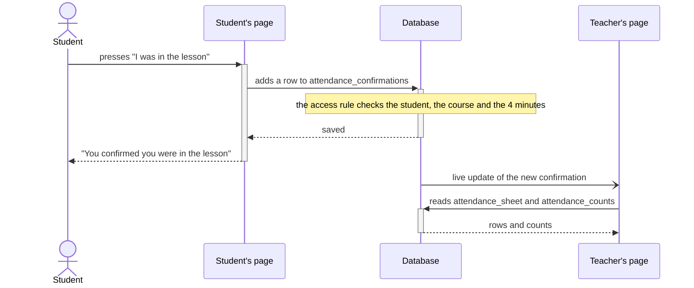
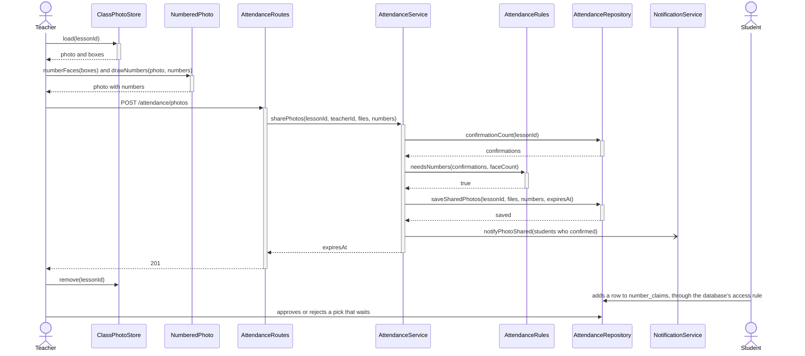
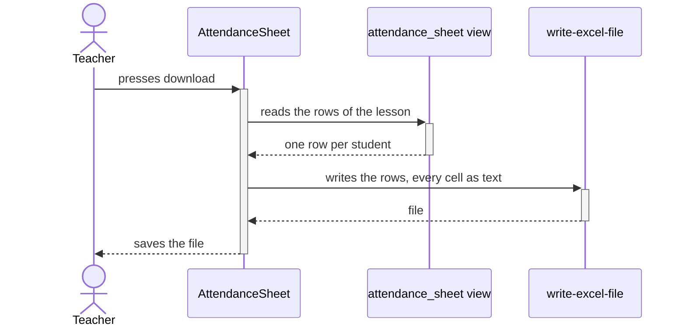

# EDD-Attendance: Attendance

- Component: SDD §2.3 Face tools, §2.4 Attendance, §2.9 Notifications
- Requirements: REQ-10 to REQ-19, REQ-76, NFR-03, NFR-04, NFR-09, NFR-10
- Use cases: UC-01
- Decisions: [F1 decisions](../features/F1-attendance-strategy.md), [ADR-10](../02-tools-report.md#adr-10-attendance-by-confirmation-checked-against-a-face-count)

## 1. Module and class design

`FaceEngine`, `ClassPhotoStore`, `NumberedPhoto` and `AttendanceSheet` run in the browser, and the rest on our server. A student's confirmation and pick, and the teacher's decisions and changes, go straight to the database under its access rules. The server does only what the page may not: it starts a round and saves the shared photo.

## 2. Algorithms and data structures

**Counting the faces, in the browser.** YuNet finds the faces at confidence 0.5, in a photo of up to 12 MP. Only the number of faces leaves the phone. The photo and its face boxes stay in the browser's storage (`ClassPhotoStore`), for at most 25 hours.

**The check (REQ-13, REQ-14).** When the 4 minutes end, `AttendanceRules.needsNumbers` compares the confirmations with the faces. More confirmations than faces means someone confirmed without being in the hall.

**The numbers.** Every face gets a number, from left to right by the middle of its box, so "number 32" names one face. The teacher's phone draws a frame and the number on each face, and only that copy is shared.

**The result (REQ-13).** The view `attendance_status` gives each student of the course one result in each lesson, in the order of the SRS table:
1. The teacher's own decision (REQ-76).
2. No photo, or the 4 minutes still running.
3. No confirmation.
4. No more confirmations than faces.
5. Then the picks.

The teacher reads it through `attendance_sheet`, and a student reads their own row through `my_attendance`. Nothing is stored as a result, so a pick, a decision or the end of the 4 minutes changes the result with no job.

**Picks.**
- A student has one pick per lesson. A pick with no number says "I am not in the photo".
- A pick of a number that no other student picked counts at once.
- The teacher decides the others. When the teacher approves one pick of a number, a database trigger rejects the other picks of that number, and a unique index allows at most one approved pick per number.

**Deleting.**
- The teacher's phone deletes the photo right after sharing it, or once the 4 minutes end with no need to share (NFR-10).
- The server deletes a shared photo 24 hours after sharing. It looks for such photos when it starts and every 10 minutes (NFR-09).

**Notifications.** The server sends Web Push messages with the `web-push` library: to the whole course when the round starts, and to the students who confirmed when the teacher shares the photo.

**The life of a round:**

## 3. Database schema and data formats

| Table, view or file store | Main columns | Access |
|---------------------------|--------------|--------|
| `attendance_rounds` | `lesson_id` (key), `created_at`, `expires_at`, `face_count` | Read: everyone linked to the lesson. Write: the server |
| `attendance_confirmations` | `lesson_id` and `student_id` (key), `created_at` | Read: the student's own row, and the teacher. Add: the student, for themselves, within the 4 minutes |
| `attendance_counts` (view) | `face_count`, `expires_at`, `confirmations` | Read: everyone linked to the lesson. It names no student |
| `shared_photos` | `lesson_id` and `photo_no` (key), `file_path`, `shared_at`, `expires_at`, `file_removed` | Read: everyone linked to the lesson. Write: the server |
| `photo_numbers` | `lesson_id` and `number` (key), `photo_no`, `face_no`, `box` | Read: everyone linked to the lesson. Write: the server |
| `number_claims` | `lesson_id` and `student_id` (key), `number` (empty for "not in the photo"), `status`, `created_at`, `decided_at` | Read: the student's own row, and the teacher. Add: a student who confirmed, while the shared photo is up. Decide: the teacher, while the pick waits |
| `my_number_claim` (view) | `number`, `status`, `contested` | Read: the student's own pick |
| `attendance_overrides` | `lesson_id` and `student_id` (key), `present`, `decided_at` | Read and write: the teacher of the lesson, for students of its course |
| `attendance_status` (view) | One row per student and lesson: `attendance`, `decided_by`, `confirmed`, the pick | Closed to the page |
| `attendance_sheet` (view) | One row per student, with the flag | Read: the teacher |
| `my_attendance` (view) | `attendance`, `decided_by`, `confirmed` | Read: the student's own rows |
| `push_subscriptions` | `student_id`, `endpoint`, `p256dh`, `auth` | The server only |
| File store `class-photos` | The shared photo, a JPEG of up to 10 MB | Read: the teacher, and a student who confirmed while the photo is up |

**Values.**
- `attendance` is one of `present`, `absent`, `pending`, `confirmed`, `waiting` or `no_photo`.
- `decided_by` is one of `confirmation`, `photo_number` or `teacher`.

**The calls.**
- `POST /attendance/class` takes `{ lessonId, faceCount }`.
- `POST /attendance/photos` takes a form with `lessonId`, `photoNos` (`[0]`), `numbers` (`[{ number, photoNo, faceNo, box }]`, one for every face) and one JPEG in `photos`.

**The attendance sheet file** has the columns ID number, name, attendance, how it was decided and a note for flagged students. Every cell is written as text, from right to left (ADR-6).

## 4. Sequence diagrams for key flows

The teacher photographs the class:

A student confirms, and the teacher's sheet updates:

More students confirmed than there are faces:

The teacher downloads the sheet, which is written in the browser:

## 5. Error handling and edge cases

| Case | What happens |
|------|--------------|
| No photo in the lesson (UC-01, 1a) | No student can confirm, and the teacher marks attendance by hand |
| The teacher leaves the page while the photo is processed (UC-01, 2a) | The work goes on in the background, and a short message shows when it ends |
| A second photo, a photo outside the lesson, or a face count that is not a whole number from 0 to 500 | Refused with `round_exists`, `outside_lesson` or `bad_count` |
| A confirmation after the 4 minutes, a second one, one for another student, or from another course (UC-01, 4a) | The database's access rule refuses it |
| A share within the 4 minutes, with no need, a second time, or with numbers that miss a face | Refused with `round_open`, `no_need`, `already_shared` or `bad_numbers` |
| The photo is not on this phone | The tab says that the photo can be shared only from the phone that took it |
| Two picks of one number, or "not in the photo" (UC-01, 6c) | Both wait for the teacher. Approving one pick of a number rejects the others, and the rejected student is flagged |
| No pick within 24 hours (UC-01, 6d) | The result is `absent` once the photo is deleted |
| No network when confirming | The page says the confirmation was not sent, and the student can press again within the 4 minutes |

## 6. Configuration and performance budget

- **4 minutes** to confirm, set in the database function `start_attendance_round`.
- **24 hours** for a shared photo (`SHARE_HOURS`).
- **One photo** in a lesson (`MAX_PHOTOS`), with up to 500 faces (`MAX_FACES`).
- **A shared photo of up to 10 MB.**
- **The server looks for expired photos every 10 minutes.** While a pick or a share waits, the student's page asks again every 30 s.

Budget: a confirmation within 2 s in 95% of cases (NFR-03), and 2 minutes to find the faces in a photo of 50 faces (NFR-04).

## 7. Alternatives considered and trade-offs

- **Counting faces against recognising each face (ADR-10):** in a real hall, recognition marked a student present on another person's face.
- **One photo against up to three:** with no recognition, a person in two photos would be counted twice.
- **Confirming straight to the database against a call to our server:**
  - The free server sleeps.
  - The access rule already checks the student, the course and the 4 minutes.
- **A view that works out the result against stored results:**
  - The rules sit in one place.
  - A pick, a decision or the end of the 4 minutes changes the result with no job.
- **Sharing from the phone that took the photo against uploading it at once:** the photo reaches the server only when it is needed.

## 8. Testing and rollout plan

- **Unit tests:**
  - `AttendanceRules` and `AttendanceService`, with a fake repository.
  - In the browser: the numbers, the count sentences, the pick sentences and the sheet cells.
- **On the database:**
  - Who may confirm and when.
  - Every result of the sheet.
  - The rules of sharing, the picks and the teacher's decision on them.
  - The teacher's own change.
  - Deleting a shared photo.
- **In the browser:**
  - Photographing the class.
  - Confirming.
  - The live sheet.
  - More confirmations than faces, with two students on one number.
  - Sharing only from the phone that took the photo.
  - The teacher's change.
  - The download.
- **Rollout:** the database change deletes the tables of face recognition. It runs on the live database only after the team approves.
