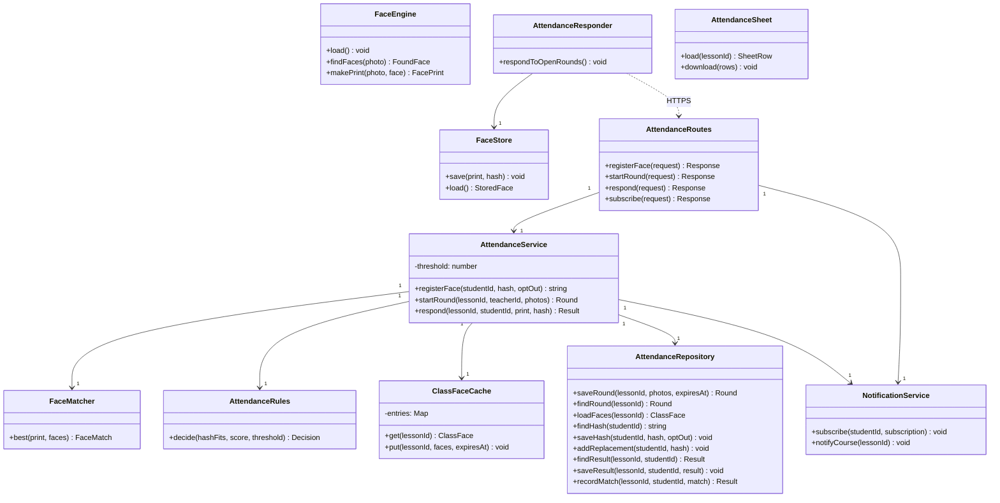
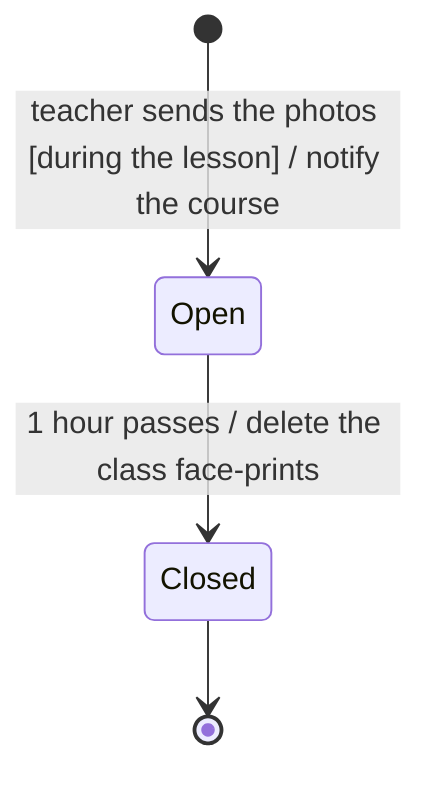

# EDD-Attendance: Attendance

- Component: SDD §2.3 Face tools, §2.4 Attendance, §2.9 Notifications
- Requirements: REQ-07 to REQ-19, NFR-03, NFR-04, NFR-09, NFR-10
- Use cases: UC-01, UC-06

## 1. Module and class design

`FaceEngine`, `FaceStore`, `AttendanceResponder` and `AttendanceSheet` run in the browser, and the rest on our server.

## 2. Algorithms and data structures

**Face-print, in the browser.** YuNet finds the faces at confidence 0.5, in a photo of up to 12 MP, and SFace turns each aligned face into 128 numbers. The photo never leaves the phone.

**Hash.** SHA-256 over the bytes of the face-print. The phone calculates it at registration, and the server on every response.

**Result (REQ-13).** The server takes the highest cosine similarity against every face of the round, and then:

1. If the hash does not fit, the result is `review`, with no comparison.
2. If the best score is below the threshold, the result is `not_found`.
3. Otherwise the database function `record_attendance_match` locks that face. If no other student matched it, the result is `present`. If one did, they all get `conflict`, even a student who already had `present`.
4. A student who sent nothing has no row, and the sheet shows `no_response` after the hour.

**The sheet.** The view `attendance_sheet` merges results with row-and-seat requests and sets the flag of REQ-17. A teacher's decision changes only the request.

**Deleting.** A student's face-print is overwritten right after the comparison (NFR-09). A database job runs every minute and deletes the class face-prints of finished rounds, and `ClassFaceCache` drops them at the same moment (NFR-10).

**Replacing a face (REQ-09).** A teacher approves the new hash from the page, and a database trigger applies it.

**Notifications.** After the round is saved, the server sends Web Push messages with the `web-push` library.

**The life of a round:**

## 3. Database schema and data formats

## 4. Sequence diagrams for key flows

## 5. Error handling and edge cases

## 6. Configuration and performance budget

## 7. Alternatives considered and trade-offs

## 8. Testing and rollout plan
