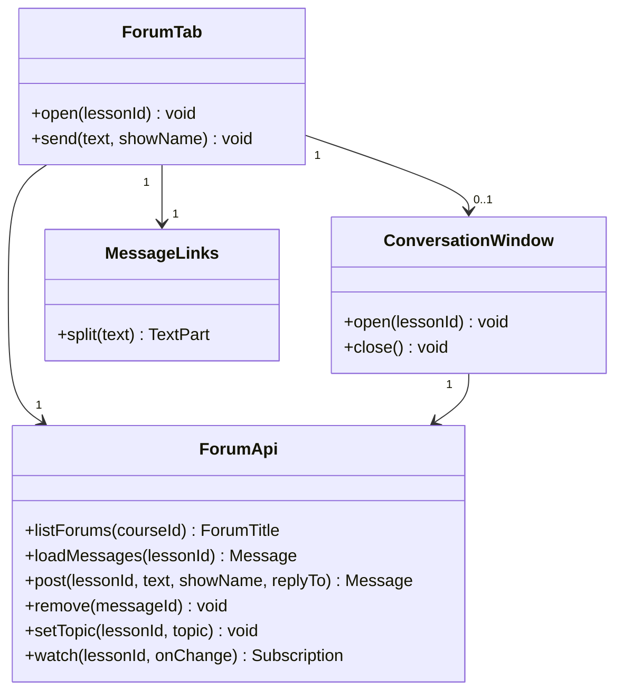
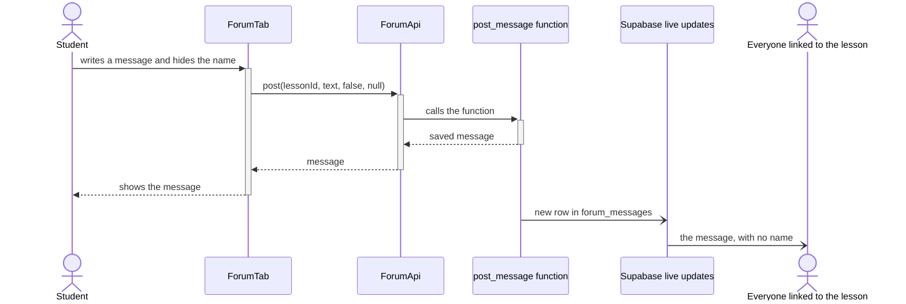

# EDD-Forum: Forum

- Component: SDD §2.5 Forum
- Requirements: REQ-20 to REQ-29, REQ-70, NFR-02
- Use cases: UC-02

## 1. Module and class design

All the classes run in the browser. The forum has no code on our server.

## 2. Algorithms and data structures

**Posting.** The page calls the database function `post_message`. In one transaction it takes the writer from the sign-in token, saves the message and saves the writer in a separate table. The name is copied onto the message only if the writer chose to show it.

**Deleting.** `remove_message` empties the text and the name. The row stays, so replies keep their place, and the change reaches the pages as an update, because Supabase applies no access rules to delete events.

**No editing (REQ-28).** No user may update the table, and only the two functions change it.

**Links.** Text is always shown as text, and web addresses become links.

## 3. Database schema and data formats

| Table | Main columns | Access |
|-------|--------------|--------|
| `forum_messages` | `id`, `lesson_id`, `reply_to`, `text`, `writer_name` (empty when hidden), `created_at`, `deleted_at` | Read: everyone linked to the lesson. Write: only through the two functions |
| `message_writers` | `message_id` (key), `writer_id` | Read: the teacher of the course and the writer. Write: only through `post_message` |
| `lessons` | `topic` | Read: everyone linked to the lesson. Write: the teacher of the course |

A lesson has exactly one forum, so the forum needs no table of its own. A forum's title is the course name, the lecture number and `topic`.

## 4. Sequence diagrams for key flows

A student posts a message with a hidden name:

## 5. Error handling and edge cases

- **No network:** the message stays in the box, and the user can try again (UC-02, 3a).
- **An empty message, one that is too long, or a user who is not linked to the lesson:** refused by `post_message`.

## 6. Configuration and performance budget

A message has up to 2,000 characters. Budget: a new message reaches everyone within 2 s in 95% of cases (NFR-02).

## 7. Alternatives considered and trade-offs

- **Emptying a message against deleting the row:** delete events skip the access rules, and replies would lose their place.
- **A separate table for the writer against a hidden column:** access rules work on whole rows.

## 8. Testing and rollout plan

- **Unit tests:** `MessageLinks` and `ForumApi` with a fake client.
- **On the database:** `post_message` with a shown and a hidden name, and `remove_message`.
- **Rollout:** built after attendance, together with polls and forms.
