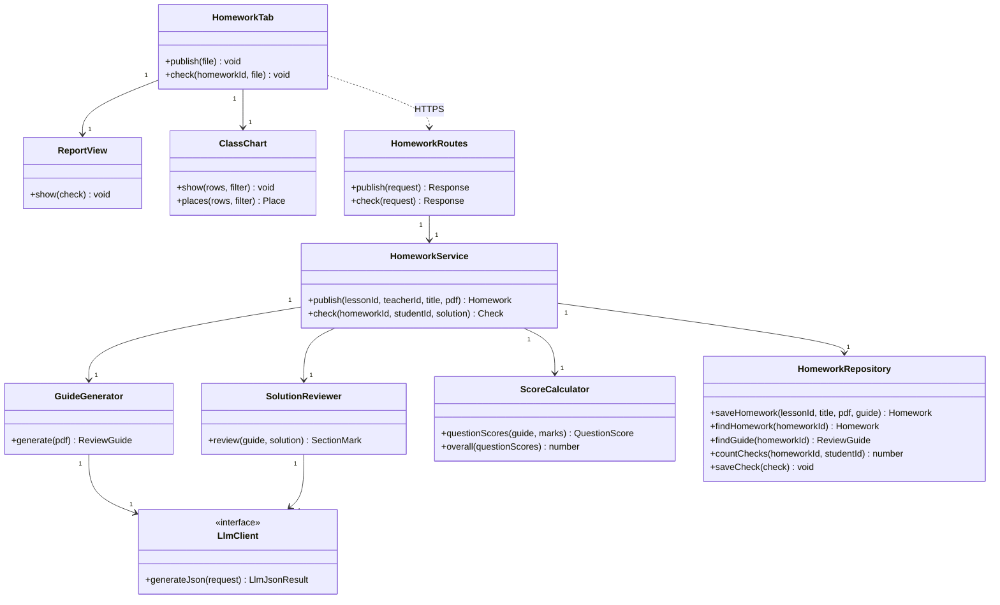
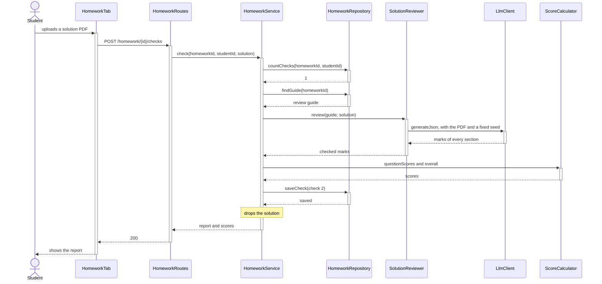

# EDD-HomeworkReview: Homework review

- Component: SDD §2.8 Homework review
- Requirements: REQ-50 to REQ-59, NFR-01, NFR-06
- Use cases: UC-05

## 1. Module and class design

`HomeworkTab`, `ReportView` and `ClassChart` run in the browser, and the rest on our server. `LlmClient` already exists.

## 2. Algorithms and data structures

**Publishing (REQ-50, REQ-51).** The server saves the PDF in file storage, and `gemini-3.6-flash` makes the review guide from it once: the questions and their sections, and for each section what it asks, its requirements, the expected result, score bands and what would give the answer away. Every check of the homework uses the guide unchanged. If the guide fails, nothing is published and the teacher can try again.

**Checking (REQ-52 to REQ-54, REQ-58).** `gemini-3.5-flash-lite` reviews the solution PDF against the guide, with the stricter wording, a fixed seed and a JSON schema of the guide's section IDs (ADR-9). The server then checks the answer:

1. Exactly the sections of the guide, with integer scores from 0 to 100.
2. A section not answered has 0, and an answered section with 0 is lifted to 1.
3. A rejected answer is asked for again with another seed, because the same seed returns the same answer.
4. A report with Arabic letters is asked for again once, with another seed.

**Scores (REQ-55).** A question's score is the plain average of its sections, and the overall score is the plain average of the questions, rounded, at least 1.

**Checks (REQ-56).** A student has 3 checks per homework. A check that fails for a technical reason is not saved, so it does not count. The chart uses each student's latest check.

**The chart (REQ-57).** The view `homework_chart` gives the latest scores of every checked student. The page orders them, equal scores share a place, and a filter switches between the overall score, a question and a section.

**The solution file (REQ-59).** The solution stays in the server's memory, goes to the AI service inside the request, which keeps nothing, and is dropped when the check ends.

## 3. Database schema and data formats

| Table, view or storage | Main columns | Access |
|------------------------|--------------|--------|
| `homework` | `id`, `lesson_id`, `title`, `file_path`, `created_at` | Read: everyone linked to the lesson. Write: the server |
| `review_guides` | `homework_id` (key), `questions`, `system_prompt` | The server only, because it holds the expected answers |
| `homework_checks` | `homework_id`, `student_id` and `check_number` (key), `created_at`, `section_scores`, `question_scores`, `overall`, `report` | Read: the student's own rows. Write: the server |
| `homework_chart` (view) | The latest check of each student: name, `overall`, `question_scores`, `section_scores` | Read: everyone linked to the lesson. It holds no report |
| Storage bucket `homework` | The PDF of each homework | Read: everyone linked to the lesson |

`report` holds, for each section, `answered`, `score`, `meets`, `missing` and `direction`.

## 4. Sequence diagrams for key flows

A student checks a solution:

## 5. Error handling and edge cases

- **Three checks used (UC-05, 2a):** refused with `no_checks_left`.
- **A section not answered (UC-05, 3a):** it gets 0, with a notice at the top of the report.
- **A technical failure (UC-05, 3b):** `ai_unavailable`, nothing is saved, and the check does not count.
- **A file that is not a PDF, or over 20 MB:** refused with `not_a_pdf` or `file_too_large`.

## 6. Configuration and performance budget

The review model is `gemini-3.5-flash-lite` (`GEMINI_REVIEW_MODEL`) and the guide model `gemini-3.6-flash` (`GEMINI_TEXT_MODEL`), with the seed 20261109 and PDFs of up to 20 MB. Budget: a report on 20 pages within 3 minutes (NFR-06); the spike took 4.5 and 8.1 s.

## 7. Alternatives considered and trade-offs

- **One review per check against the median of 3:** the median triples the requests and still moved a section by 25 points.
- **The light model for the reviews and the stronger one for the guide:** a guide is one request per homework, and it was tested with the stronger model (ADR-9).

## 8. Testing and rollout plan

- **Unit tests:** `ScoreCalculator`, `SolutionReviewer` and `GuideGenerator` with `FakeLlmClient`, `HomeworkService` with a fake repository, and `ClassChart`.
- **On the database:** the report only for its student, the chart for everyone, and the guide closed to the page.
- **Real run:** the spike's test set before each release, as the manual test cases of the homework review.
- **Rollout:** built last.
