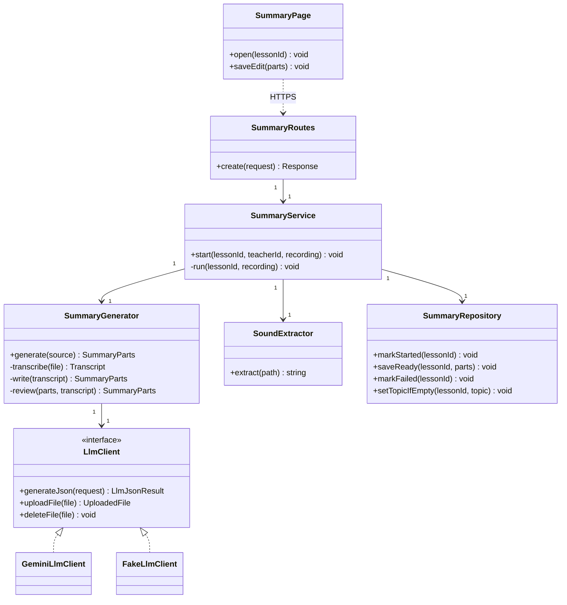
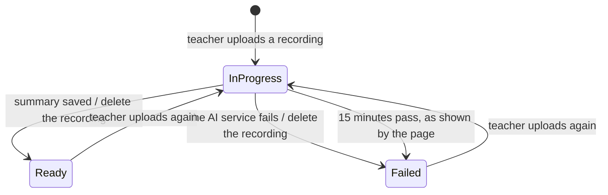
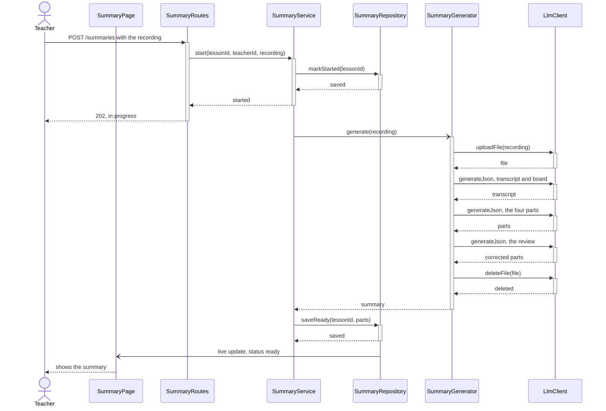

# EDD-LessonSummary: Lesson summary

- Component: SDD §2.7 Lesson summary
- Requirements: REQ-40 to REQ-49, NFR-05
- Use cases: UC-04

## 1. Module and class design

`SummaryPage` runs in the browser and the rest on our server. `LlmClient` and its two implementations already exist.



## 2. Algorithms and data structures

**Making a summary (REQ-43 to REQ-46).** Three requests through the LLM layer, each with a JSON schema (ADR-2):

1. With the video: a transcript with speaker labels, and what was on the board.
2. From them: the four parts of the page and the lecture topic, with an overview of up to 300 words.
3. A review against the transcript and the board list, which corrects spelling and garbled copying and adds nothing.

**Sound alone (REQ-44).** `SoundExtractor` copies the sound track with ffmpeg, and request 1 runs on it.

**In the background.** The server answers when the upload ends and continues alone, and the page learns the result from the row in the database.

**Deleting (REQ-48).** The recording is deleted from the server and from Google when the work ends, whether it succeeded or failed.

**The forum title (REQ-49).** If the lesson has no topic, the server copies it from the summary.

**The life of a summary:**



## 3. Database schema and data formats

| Table | Main columns | Access |
|-------|--------------|--------|
| `lesson_summaries` | `lesson_id` (key), `status`, `started_at`, `finished_at`, `overview`, `topics`, `questions`, `board` | Read: everyone linked to the lesson. Write: the server, and the teacher only the four parts |

`status` is one of `in_progress`, `ready` or `failed`. The answer of request 2 has this form:

```json
{
  "overview": "...",
  "topics": [{ "title": "...", "start": "02:15" }],
  "questions": [{ "time": "05:40", "question": "...", "answer": "..." }],
  "board": [{ "time": "03:10", "content": "..." }],
  "lesson_topic": "..."
}
```

## 4. Sequence diagrams for key flows

The teacher uploads a recording:



## 5. Error handling and edge cases

- **The AI service does not answer (UC-04, 2b):** the status is `failed`, and the teacher can upload again.
- **The server stops in the middle:** the status stays `in_progress`. After 15 minutes the page shows that it failed, and the teacher uploads again.
- **The lesson has not ended:** refused with `lesson_not_ended` (REQ-41).

## 6. Configuration and performance budget

The model is `gemini-3.6-flash` (ADR-2), and a recording can be up to 200 MB. Budget: ready within 5 minutes of the end of the upload, for a 10-minute recording (NFR-05).

## 7. Alternatives considered and trade-offs

- **In the background against waiting for the answer:** a phone can lock its screen during the minutes it takes.
- **Not storing the transcript:** the page does not show it.

## 8. Testing and rollout plan

- **Unit tests:** `SummaryGenerator` with `FakeLlmClient`, and `SummaryService` on success and on failure.
- **Real run:** one real recording before each release.
- **Rollout:** built after the forum.
