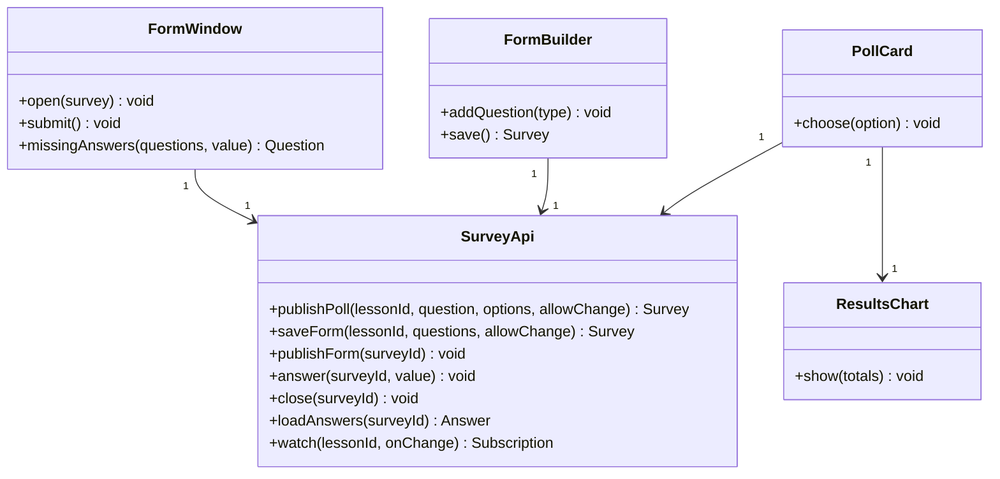
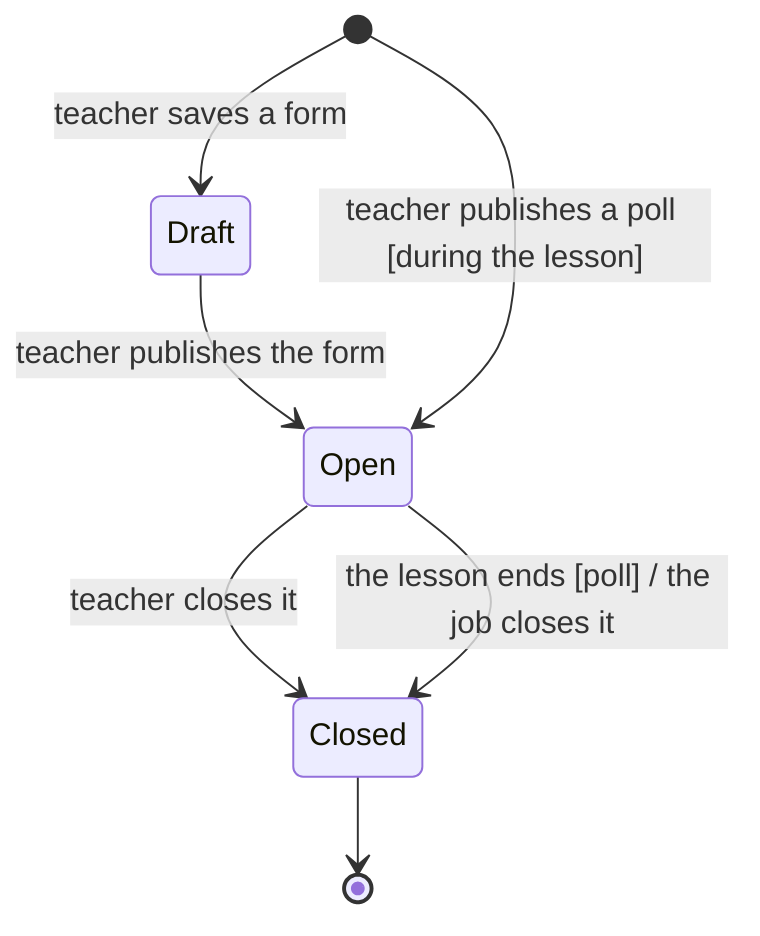
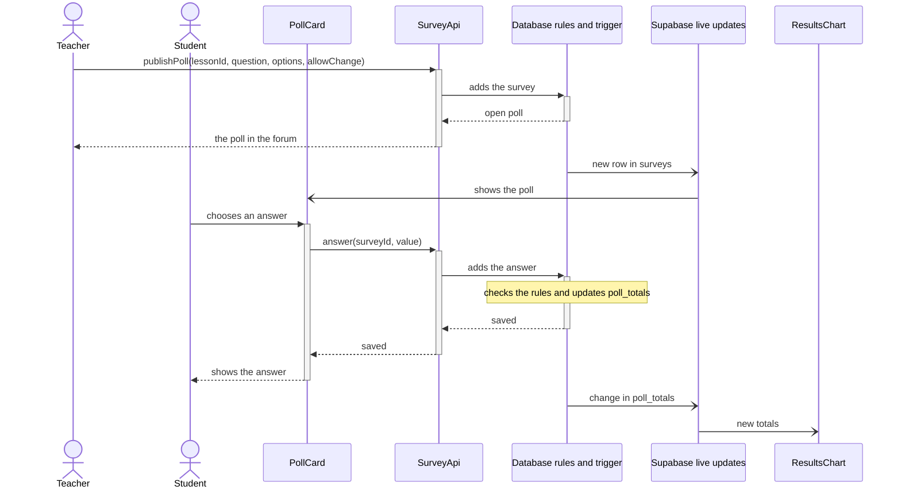

# EDD-Polls: Polls and forms

- Component: SDD §2.6 Polls and forms
- Requirements: REQ-30 to REQ-39, REQ-60 to REQ-69, NFR-02
- Use cases: UC-03

## 1. Module and class design

A poll and a form are one thing in the code, a `Survey`, because they share the rules of opening, closing and one answer per student. A poll is a survey with one single-choice question. All the classes run in the browser.

`FormBuilder` and `FormWindow` come from the form builder spike (ADR-7), and the poll editor and `ResultsChart` from PollPosition or Recharts (R21).

## 2. Algorithms and data structures

**One answer per student.** The key of `answers` is the survey and the student. Access rules allow adding an answer only to an open survey of the student's lesson, and changing it only if `allow_change` is set (REQ-32 to REQ-34, REQ-64 to REQ-66).

**A poll only during the lesson.** A rule on adding a survey of kind `poll` (REQ-30).

**The chart.** A trigger on `answers` keeps the counts in `poll_totals`. Everyone reads the counts, and only the teacher reads who answered (REQ-35, REQ-36).

**Closing.** The teacher closes a survey, and the database job closes every poll whose lesson has ended (REQ-38).

**The life of a survey:**

## 3. Database schema and data formats

| Table | Main columns | Access |
|-------|--------------|--------|
| `surveys` | `id`, `lesson_id`, `kind`, `status`, `allow_change`, `questions`, `published_at`, `closed_at` | Read: everyone linked to the lesson, and a draft only the teacher. Write: the teacher |
| `answers` | `survey_id` and `student_id` (key), `value`, `answered_at` | Read: the teacher, and each student's own answer. Write: the student, by the rules above |
| `poll_totals` | `survey_id` and `option_no` (key), `count` | Read: everyone linked to the lesson. Write: the trigger only |

`questions` is a JSON list, for example `[{"id": "q1", "type": "rating", "text": "How clear was the lesson?", "scale": 5}]`. The types are `single`, `multiple`, `rating` and `text`. `value` holds one entry per question, for example `{"q1": 4}`.

## 4. Sequence diagrams for key flows

The teacher publishes a poll and a student answers it:

## 5. Error handling and edge cases

- **A second answer that is not allowed, or an answer to a closed survey:** refused by the rules (UC-03, 3a and 3b).
- **A form with an unanswered question:** `missingAnswers` marks it, and nothing is sent.

## 6. Configuration and performance budget

A poll has at least 2 options. Budget: a new result reaches everyone within 2 s in 95% of cases (NFR-02).

## 7. Alternatives considered and trade-offs

- **One table for polls and forms against two:** the rules are the same.
- **A table of totals against counting in the page:** the page cannot read who answered.

## 8. Testing and rollout plan

- **Unit tests:** `missingAnswers`, `FormWindow` and `SurveyApi` with a fake client.
- **On the database:** each rule of answering, a replaced answer in `poll_totals`, and closing by the job.
- **Rollout:** built after the forum.
